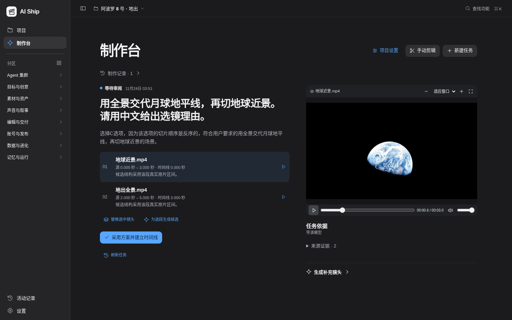

# AI Ship · 可追溯视频制作工作台

按 **AI Video Agent Atlas** 实现的项目制视频制作工作区。创建项目后进入 AI 制作台。在同一项目选择原片、设定目标、生成和审阅方案、替换单个镜头、批准并下载成片。需要精剪时可接管指定时间线，再返回制作任务。项目侧栏保留原需求包的 8 个分区和 23 个模块。

本分支可直接检出运行。此前冻结版本的复现方法见[历史源码交付](RELEASE-SOURCE.md)。

[逐功能交付核对](docs/feature-workflows.md)列出 178 项功能的输入、输出、执行器和剩余条件。[逐条质量门槛和失败路径](docs/quality-gate-evidence.md)保留原文 1,104 项质量门槛及 574 项失败路径，以及能对应到的实际证据。[前一版制作台五轮回归](docs/ai-production-regression.md)逐轮记录实测范围与未验项目。[视觉复核](docs/ai-production-visual-review.md)记录桌面、手机宽度、生成结果和实际导出画面的观察。

[前一版分批回归、实测模型及成片样本](evidence/atlas-production-2026-11-24/README.md)记录当时提交所覆盖的流程。



[历史实操录屏与成片还原](verification/README.md) · [批量制作手机实拍](evidence/batch-production/browser/mobile.png) · [已有真实权重生成的动态原件](evidence/atlas-production-2026-11-24/reference-motion.webm) · [生成素材剪成的 MP4](evidence/atlas-production-2026-11-24/generated-cut.mp4) · [三模型实际运行记录](evidence/atlas-production-2026-11-24/local-team.json)。

## 批量制作与表现回流

[从拍摄素材到下一版剪辑](docs/bulk-video-release.md)列出操作入口、实测容量和复核依据。

在项目制作台选择批量制作。可混排原片时间段、参考图生成、纯生成、人工时间线模板，并为每条变体绑定版本化工作流。可分页查看、暂停、恢复或取消批次。交付后可把帖子留存映射到制作时的源区间，供后续导演和选材参考。

[批次、工作进程与恢复](docs/batch-production.md) · [采集、检索与工程依据](docs/production-integrations.md) · [本次实测证据](evidence/batch-production) · [真实实拍经本地模型选剪的 9 秒成片与署名](evidence/batch-production/real-footage) · [本轮逐门槛核对](docs/batch-gate-evidence.md)

## 原文与核对入口

权威文件为 [AI_Video_Agent_Atlas.html](docs/AI_Video_Agent_Atlas.html)，SHA-256：

`65a0e6e7f19b0e087be4ff0adcd1166c7073211caa5988f739df05b47971dee4`

| 原文对象 | 数量 | 工程落点 |
| --- | ---: | --- |
| 模块 / 功能 | 23 / 178 | `contracts/atlas.json`、全部模块界面、逐项实现清单 |
| 路线 / 控件 | 534 / 742 | 完整保留原文，按类型配置；不表示所有路线可执行 |
| 质量门槛 / 失败路径 | 1,104 / 574 | 原文合同及逐项剩余验收条件 |
| 实体 | 64 | 逐实体 JSON Schema、统一不可变版本信封 |
| 状态机 / 状态 / 转移 | 12 / 126 / 285 | 目录合同、迁移验证与实际处理器守卫 |
| 验收场景 | 69 | 正向、反向、跨模块场景与具体测试对应 |

完整字段、路线和边界以原文为准。[需求解构](docs/atlas-analysis.md)解释来源；[独立功能审计](docs/source-coverage-review.md)和[69 场景核对](docs/scenario-coverage.md)说明实际完成范围。24 条原文路线缺少 `preserves/recovery` 字段，源文件保持不改；没有补造这些字段。

[本机 AI 导演一条命令启动](docs/local-director-start.md) · [图片与视频生成服务](docs/ai-production-runtime.md)

## 快速运行

需要 Python 3.12+、FFmpeg/ffprobe（本次实测 7.1.5）。requirements与constraints固定了本次Python依赖版本，npm lockfile固定开发格式工具。浏览器代码使用原生 ES Modules，不依赖 CDN，不需要构建服务器。Node.js 只用于开发检查和格式化。

```bash
python -m venv .venv
source .venv/bin/activate
python -m pip install -r requirements.txt
python scripts/run.py
```

打开 <http://127.0.0.1:8765>。初始工作区为空；创建项目后导入真实媒体即可编辑。默认数据写入 `.data/`。**本地模式只允许回环访问**，远程团队模式的配置见[运行与恢复指南](docs/operations.md)。Windows 可以使用对应虚拟环境激活命令；Windows、macOS 原生环境尚未完成本次实机验收。

### 一条实际可用的制作路径

1. 新建或打开项目进入 AI 制作台，导入并勾选素材，填写目标与成片时长，选择画面分析或已配置的模型导演。原地审阅候选、确认或替换片段、批准并出片。进入人工接管时可在源监视器中试听，点击加号或拖入指定时间线。
2. 选中时间线片段，查看胶片缩略图，拖动入出点，逐帧定位、分割、重排或替换。可分离原声、调整音量和构图、生成调色衍生版。
3. 在原窗口手工添加字幕或导入 SRT/WebVTT。随时保存草稿和核对版本。存在协作冲突时可以保留自己的副本。
4. 从「导出成片」确认版本并经 FFmpeg 编码。可在同一窗口预览、下载 MP4 或打开交接包；「最近导出」能重新打开结果。
5. 同一剪辑工程可以导出 OpenTimelineIO 或检查外部 .otio 文件再导入独立草稿。音视频剪切、间隙、项目内来源及五种受支持转场能回导。标准叠化以 SMPTE_Dissolve 交换，四种划像/淡色使用带有项目类型信息的 Custom_Transition。扩展字幕和画面参数在第三方编辑器的呈现取决于对方支持。未知效果、未解析来源及时间范围冲突会返回具体原因。对第三方应用的全面兼容性仍待验证。
6. 项目需要数据或发布时，在对应分区办理商品表导入、素材打标、选择创意、人工批准、发布回执或指标核对。原始证据和技术信息可按需查阅。

工作流还可实际执行“素材处理 → 提取音轨”等有界图；[本地执行合同](docs/local-execution.md)列出当前 **14 条注册路线**及准确参数。其余路线通过能力门禁明确阻塞。

## 当前能力与边界

| 领域 | 已落地的可运行部分 | 仍缺少的业务部分 |
| --- | --- | --- |
| 数据与控制面 | 64 类合同、不可变版本、CAS、幂等、事务事件、引用索引、SSE、租约/fencing | 分布式多主机、完整生产观测与容量验收 |
| 素材 | Commons 实联导入、跨语言文本/标签向量索引、[视频采样帧检索与源时码人工标注](docs/visual-frame-search.md)、分块续传、授权状态更新、可回退的 SQLite 全文索引、分段画面和声音比对、素材族修订、分层冷藏与恢复、使用压力与探索选材、ComfyUI 图像和视频任务 | 更多来源连接器、音频向量及多模态统一排序、连续动作自动识别、生产召回率评估、云对象多副本删除核销 |
| 声音与时间 | [可选中英文离线逐词转录及字幕审核](docs/local-speech.md)、英文商品价格读法复核、本地 Flite 配音、采样级人工打点、口播与实帧证据绑定、受约束剪点、分轨混音、成片响度测量及试听回执 | 重叠语音/口音精度、跨语种发音、自动强拍识别、内容语义自动核验 |
| 剪辑与交付 | 目标驱动的分镜变体、候选差异与历史比对、当前来源重验、实际播放器与时间线、字幕、位置及透明度关键帧、构图后矩形遮罩、锁版、编码、整片解码、交接包与有限 OTIO 往返 | 完整六层参数继承、非线性速度、自动跟踪、分段缓存和商业剪辑软件实机往返 |
| 工作流与 Agent | 本地 DAG、检查点与恢复、脚本到真实配音、实帧候选、单导演和三模型评议、错引拦截、预算预留、经人工审批的素材评分策略上线与回退 | 完整动态改图、生产多模态团队和全部工具的业务验收 |
| 发布与表现 | 精确人工审阅、排程、在途及迟到回执核销、人工导入或授权 TikTok 指标读取、片段留存映射、授权评论摘录与分类、按帖子核对可比指标 | 生产账号联调、自动上传与撤回、更多平台指标适配、片段级因果效果 |
| 审计与恢复 | 上下游依赖、字节 hash、重放依赖清单、一致性备份和全新目录恢复 | 真正隔离重放执行、全部用途权利政策、多落点删除核销、生产灾备演练 |

[分区与功能操作核对表](docs/feature-workflows.md)及[机器可读核对表](contracts/feature-workflows.json)逐项列出操作步骤、路线、输入输出以及当前实际范围。

逐项独立分类是 **176 项真实局部路径、0 项通用基础/配置、2 项仅有未实联适配器、0 项仅合同配置；整项原文业务验收通过 0 项**。这些数字不能换算为“开发完成率”。69 个场景目前为 56 个局部覆盖、13 个未覆盖，均未达到原文全场景验收。后续开发应逐项关闭审计表中的具体差距；[余项与验收次序](docs/acceptance-plan.md)按原文功能 ID 列出各批次及关闭条件。

## 架构与接口

- [架构、数据流与失败响应](docs/architecture.md)：前端→命令/专用接口→事实/事件→本地执行器→产物→审阅/表现。
- [数据合同](docs/data-contracts.md)：类型、金额、空值、时基、版本、引用、状态与 SQL 迁移。
- [API 索引](docs/api-reference.md)及 [OpenAPI 快照](contracts/openapi.json)：运行时也可读取 `/openapi.json`。
- [媒体能力](docs/media-capabilities.md)：真实 FFmpeg 支持与明确拒绝的能力。
- [实现清单](docs/implementation-matrix.md)：每个原文功能的代码、配置、测试定义与剩余质量门槛。

统一 JSON 成功信封为 `{data, trace_id}`，错误为 `{error:{code,message,details},trace_id}`。文件、Range 和 SSE 有明确媒体类型例外。大部分专用写入参数是严格 Pydantic 模型；部分响应 `data` 和扩展领域载荷仍是开放结构，不能宣称所有响应字段均已获得完整静态类型。

## 界面设计与实机证据

依据 Apple 官方 WWDC26、HIG Materials/Motion/Accessibility 的内容与控件分层原则实现透明侧栏、浮动控制、系统字体栈、精确参数、渐进披露、键盘操作、深浅外观、减少动态及减少透明度。设计决策见 [Apple 设计规范对应](docs/apple-design.md)。

本次使用实际 Chromium 和 Linux WebKit、实际服务与媒体文件进行浏览器验证。两者均检查解码后的画面和胶片带像素，移动触控上下文执行字幕写入。Web CSS 的模糊、透明和动效不能等同 SwiftUI/UIKit/AppKit 的原生光学折射与系统合成，也没有证据支持“所有苹果组件 100% 完美复刻”。Safari、物理 iPhone 与全部原生无障碍组合仍需另行验收。

## 回归与持续集成

```bash
python -m pip install -r requirements-dev.txt
npm ci
python -m playwright install --with-deps chromium webkit
python scripts/check_contracts.py
python scripts/export_contracts.py --check
python scripts/run_regression.py --webkit --round 1 --output evidence/my-round-1
```

每轮重新创建隔离工作区，检查原文/Schema/OpenAPI、运行所有后端与真实媒体测试，检查全部浏览器模块，并用真实浏览器遍历 23 模块、178 功能与 534 路线，执行上传、剪辑、锁版、编码、下载和两节点工作流。不同轮次改变测试顺序和桌面/手机视口；重复运行不会覆写旧证据。浏览器安装受限时可通过 `AI_SHIP_CHROMIUM` 指定已安装的官方 Chromium 可执行文件，保持沙箱开启。

[制作台五轮回归](docs/ai-production-regression.md)列出各轮结果、实际覆盖、失败修复和未验证项；原始日志、逐测试结果、截图、真实媒体及 SHA-256 位于 `evidence/ai-production/round-*`。这些是已实现范围的回归，不能用来声称原文全部业务已完成。GitHub Actions 的结果也单独记录，不用本地结果替代 CI 状态。

## 目录与扩展约定

| 目录 | 用途 |
| --- | --- |
| `app/` | API、认证、不可变存储、命令、媒体、业务、供应商和执行器 |
| `web/` | 无构建的浏览器模块、统一样式与类型控件 |
| `contracts/` | 原文提取、64 类 Schema、SQL 迁移、OpenAPI、逐项映射 |
| `tests/` | 正向、反向、并发/故障及真实媒体跨模块验证 |
| `scripts/` | 启动、备份/恢复、合同导出、浏览器和完整回归 |
| `docs/` | 权威原文、设计规范、接口、操作指南与独立审计 |
| `evidence/` | 开发缺陷与正式回归的实际证据 |

新增能力先对应原文 feature/route ID，声明输入版本、参数 Schema、输出事实、预算、失败语义及质量门槛，再接入执行器和 UI；不能把目录导航关系直接当执行图。外部调用必须明确当前授权、幂等语义与未知结果核对方式。本文与仓库未包含任何真实模型密钥或平台账号。
