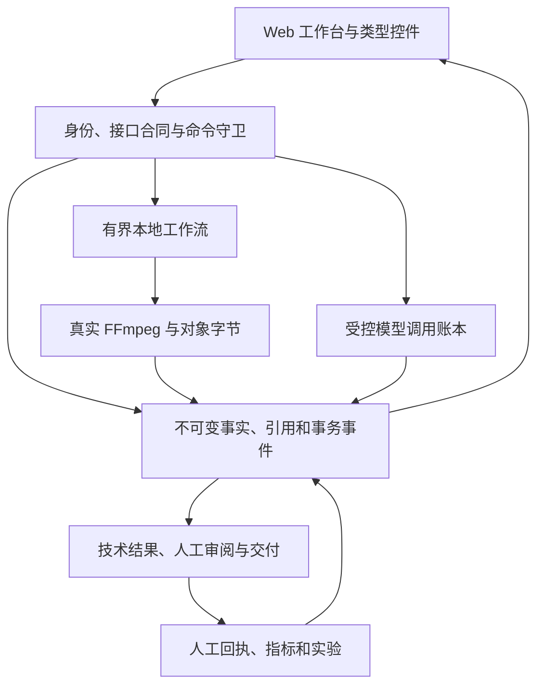

# 架构、数据流与失败响应

本文件解释已实现系统如何对应 Atlas 6.0。完整原文路线、状态、失败路径保留在 `contracts/atlas.json`，具体未完成部分以 `source-coverage-review.md` 为准。没有把工程补充的数据类型或当前最小栈冒充原文已明确规定的唯一技术选择。

## 1. 系统边界

本地默认栈是 FastAPI、SQLite WAL、租户目录下的内容寻址对象、FFmpeg/ffprobe 与浏览器 ES Modules。它适用于单节点开发/小范围验证。长调用不持有全程 SQL 写事务；每次事实提交有独立原子性。当前 API 内同步推进工作流，没有分布式后台调度服务，也没有对外自动发布器。

## 2. 数据结构与真相来源

每个业务事实由统一信封包裹：`id/kind/tenant_id/project_id/version/data/refs/created_at/hash/status`。当前指针可推进；既有 revision、引用与事件不可覆盖。`refs` 固定消费时的 ID/版本，必要时增加字段集合与半开区间。浏览器显示缓存不作为事实来源。

| 存储表 | 职责 | 关键不变量 |
| --- | --- | --- |
| `records` | 对象身份、类型、租户、项目、当前版本 | 不跨租户解析，同一对象身份稳定 |
| `revisions` | 不可变版本和内容摘要 | 新增版本，不 UPDATE 覆盖历史事实 |
| `reference_index` | 每个版本实际消费的依赖 | 导航图不产生执行依赖；字段/范围可限定影响 |
| `events` | 与事实同事务的持久事件/outbox | 已提交事实与可见事件一致，SSE 按 seq 续读 |
| `command_results` | 命令幂等结果 | 相同键/相同摘要返回原结果；不同摘要 409 |
| `leases` | 运行拥有者、有效期、fencing token | 过期/被替代 worker 不能提交结果 |
| `consumer_offsets` | 消费水位合同 | 当前没有把该表包装成完整分布式队列 |

64 类实体的原文 fields 保留；只有 21 类带较完整源 `fieldSchema`，其余结构化验证是有来源注记的工程补充。草稿允许分步骤填写；执行前再检查准确的路线必需条件。任何实体存在并不代表业务算法完成。

### 核心事实链

| 链 | 固定信息 | 当前实际用途 |
| --- | --- | --- |
| Source → Asset → AssetVersion → TransformRun | 来源、原件 hash、实际配方/版本、衍生字节 | 原件不覆写，当前权利与固定创作输入分别检查 |
| Script / Audio → VoiceMap | 文本、实际音频 hash、人工锚点和时基 | 有序区间校验；没有自动逐词对齐保证 |
| AssetVersion → Timeline → RenderManifest → Artifact | 输入版本、锁版 hash、真实工具版本、产物 hash | 基础编辑和真实渲染，技术 QC 单独记录 |
| RenderManifest → TimeMap / Usage / Cost | 源/输出 ticks、多贡献、实际使用、费用未知值 | 区间反查和账本；不能用音量权重冒充像素可见占比 |
| Artifact → Approval → Publication → Post | 精确审阅对象、冻结发布意图、人工回执 | 未实现真实平台自动提交，人工来源明确保留 |
| Post → Metric → Insight / Experiment | 时间窗、单位、币种、成熟度、分配种子 | 同口径描述统计，不能自动解释因果 |

## 3. 主要用户路径、前置条件与响应

| 入口 | 前置条件 | 成功产生 | 错误/不确定时 |
| --- | --- | --- | --- |
| 项目创建/修订 | 服务端写身份、字段结构有效 | Project revision 与事件 | 422 字段错误；409 CAS 冲突，旧版本保留 |
| 类型配置保存 | 选择合法原文功能/路线，控件值可解析 | View 配置；配置命令可登记任务合同 | 无专用执行器明确 blocked，保存不等于执行 |
| 导入 | 当前项目、文件大小/块偏移/hash 合法 | ImportEntry、Source、Asset、AssetVersion、BlobLocation | 错块不追加；重复块核对；失败条目与可续传状态保留 |
| 处理/提音/切镜头 | 实际对象可读、当前权利允许、明确受支持配方 | 衍生版本/Audio/Shot 和来源引用 | 无音轨、越界、撤权、未知配方明确拒绝；不造假输出 |
| 时间线保存 | 有效正时长片段、真实引用、CAS | 新草稿 revision | 已锁历史不动；冲突交还用户选择，不静默覆盖 |
| 锁版 | 人工确认精确 hash 与 revision | 锁定 revision | hash 或版本变化拒绝，不能沿用旧确认 |
| 渲染 | 锁定版本、当前权利、支持的滤镜/关键帧 | 实际编码文件、Manifest、TimeMap、Usage、Cost | 编码失败无伪 Artifact；技术通过仍 `publish_ready=false` |
| 本地工作流 | 冻结图、类型端口、预算/步骤/次数/时限、当前身份 | Run / ToolCall / checkpoint / 实际输出 refs | 下游阻塞；中断未知先核对；旧 worker 写入被 fencing 拒绝 |
| 模型调用 | 服务端白名单、当前身份/证据、明确计价/预算 | ToolCall、实际用量、提案、费用事实 | 超时记 outcome_unknown 并保留预留；不能换键盲重发 |
| 异构提案 | 真实不同模型/独立组、3–6 职责、独立 judge、有界预算 | 逐角色实际结果、proposed DecisionRecord | 任一未知立即停止；模型文本不被当代码执行 |
| 审阅与交付 | 精确产物版本、reviewer/owner、当前权利 | Approval、ZIP 或人工发布意图 | 到期、撤权、主体变化使预检阻塞；没有真实发送路径时 can_send=false |
| 指标导入 | 来源/时间窗/单位，空值有原因 | 不可变 Metric 快照 | 重复快照核对；未知与零不合并，不同口径不混算 |
| 实验比较 | 冻结分配、实际单元和成熟数据 | 描述性结果和不确定性 | 最新未成熟不倒退选旧成熟值；不宣称策略因果获胜 |
| 追踪/重放准备 | 实际 refs、对象 hash、当前权利 | 有界上下游投影/ReplayManifest 缺口报告 | 缺字节、坏 hash、无执行参数时阻塞；未执行重放不写 completed |
| 备份/恢复 | 可读数据库/对象、全新目标目录 | SQLite 一致性快照、字节清单、恢复校验 | 坏 ZIP/路径/大小/hash/外键失败不切换工作区 |

原文 178 功能的全部 534 方案和 574 失败路径仍需各自完成对应业务实现；表中是当前实际统一行为，并未减少原文验收义务。

## 4. 三类状态不能混用

1. **配置/规划状态**：用户选择了路线、参数或模型，不代表能力已经可用。
2. **运行状态**：Run/ToolCall 的 pending、running、checkpoint、blocked、failed、outcome_unknown、completed 等用于实际执行事实。不同子系统使用其声明的状态集合，不能由通用 CRUD 强行改成成功。
3. **业务验收状态**：精确内容、商品事实、权益、平台回执与最终效果需要单独证据。编码成功或模型返回 HTTP 200 不自动推进业务验收。

原文 12 套状态机是合同目录；状态机 `/validate` 只验证该迁移是否在声明中，不授予执行权限。实际处理器另核对角色、当前授权、版本、租约、预算、质量门槛和可用能力。

## 5. 并发、恢复与外部副作用

事实/引用/事件写在一个 `BEGIN IMMEDIATE` 事务里。CAS 防止两个编辑覆盖；命令键防重；费用预留与项目预算在同一事务核对。金额用 Decimal 统一比较，手工预留、未知结果预留和已计量费用不重复计数。已计量费用不能通过“释放预留”抹除。

本地工作流检查点保留实际输出。暂停/取消先登记请求，再等待安全边界；已经完成的输出不会消失。节点启动前及事实提交前核身份、时限、lease/fencing。底层 FFmpeg 不保证在截止毫秒精准停止，但超期 worker 不能提交为成功。产物已提交而检查点未提交时，reconcile 需要实际输出合同与执行来源，空集合或伪造上下文不能完成核对。

模型请求在 HTTP 发出前登记预留与 ToolCall。超时/网络中断可能已收费，记录 outcome_unknown 并阻断相同实际请求盲目再发。实际请求语义与预算等本地元数据分开；请求幂等键仍绑定完整输入。当前没有通用的真实供应商账单/任务状态核对器，因此未知结果需要管理员按供应商证据处理，不能通过修改记录绕过。

## 6. 参数、自由度与扩展

独立参数解析器支持项目→序列→轨道→片段→区间→关键帧，以及继承、删除覆盖、显式值、人工锁和提案。当前媒体处理器消费的是已展平的实际 clip/recipe 字段；尚未把所有原文作用域和方向规则完整接入渲染。

普通界面提供类型控件；高级对象可明确编辑结构化内容。固定引用保留选定版本，只能明确升级。Workflow 的 `parameters`、处理器的 `operation_args`、版本来源的 `input_bindings` 和布局的 `View.layout` 各自独立，拖画布不修改业务工作流版本。没有默认“全部自动”的隐式许可。

新增处理器应在 `app/execution.py` 注册 feature/route、输入 Schema、输出类型、支持限制和守卫，提供真实可验证结果及失败路径。供应商适配器只能引用服务器注册地址和环境密钥，不接受浏览器任意 URL/密钥；后续引入任务队列、对象存储或专业时间线后端必须保持当前事实和版本合同。

## 7. 接口类型的实际成熟度

OpenAPI 3.1.0 由当前 FastAPI 运行时导出，包含 60 paths / 66 operations、实体 Schema、错误信封、认证、安全边界与二进制例外。它不是原文全部 534 路线的独立 REST 实现。实体扩展载荷及部分成功响应 `data` 仍允许开放结构，尚未生成全字段严格前端 SDK。测试和 `--check` 防止已导出合同与当前代码漂移，不能代替缺失领域逻辑的设计与验收。
