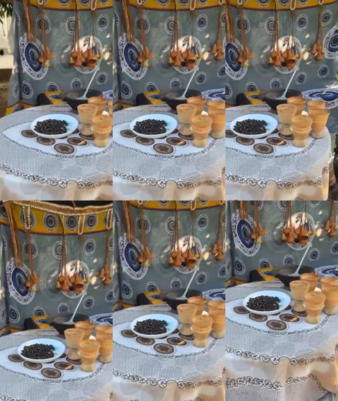

# 原照片直接制作批量运镜

同一帧咖啡仪式桌面的照片，分别套用人工设定的横移与纵移时间线，各导出一条 432 × 768、24 fps、2 秒的 MP4。每条配方只有一个镜头，固定原照片版本并锁住位置关键帧。上排是横移，下排是纵移。从左至右是第 0、24、47 帧。

| 成片 | 编码与解码 | 实测首末画面位移 | 校正位移后的平均亮度误差（8 位） |
| --- | --- | --- | --- |
| [横移](horizontal.mp4) | 48 帧，48 个不同的解码结果 | 横向 −100 像素，纵向 0 像素 | 0.0752 |
| [纵移](vertical.mp4) | 48 帧，48 个不同的解码结果 | 横向 0 像素，纵向 −184 像素 | 0.1241 |

画面可辨认桌上的杯、碟、咖啡豆和桌布。横移时，左侧碟和杯移向画面边缘。纵移时，桌面、桌布花纹与杯子的位置整体上移。从实际解码的灰度图中选择固定的 532 个中心像素，搜索使首末帧平均绝对亮度误差最小的整数位移。直接逐点比较未平移的帧，横移和纵移的误差分别为 47.1203 和 51.7519。

生产 API 以原图直接入库，经估算、创建、生产 worker、技术质检、下载，再由独立 FFmpeg 完整解码。两条 TimeMap 各自引用照片原始帧 [0, 0] 和 2 秒保持区间。两条配方的推理用量均为 0。输出是由已有像素和关键帧决定的取景区移动。提示词驱动的图生视频需单独检查生成模型与真实视觉效果。

[运行报告、来源、原图摘要、参数与成片 SHA-256](report.json) · [复验程序](../../../scripts/verify_photo_motion_batch.py)

原片为 Keria T 创作的 *Traditional Ethiopian Coffee Roasting Ceremony*，按 CC BY-SA 4.0 发布。这里从署名摘录的 1.239 秒取出原照，对其裁切、平移、编码。上述成片和拼图同样按 CC BY-SA 4.0 发布。[Wikimedia Commons 源页](https://commons.wikimedia.org/wiki/File:Traditional_Ethiopian_Coffee_Roasting_Ceremony.webm) · [许可](https://creativecommons.org/licenses/by-sa/4.0/) · [下载与原作记录](../real-footage/coffee-evidence.json)
