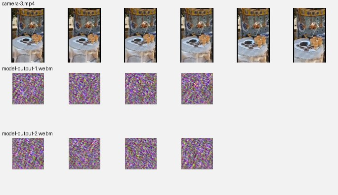

# 单张参考图的批量生成与实拍混剪实测

使用仓库已附的 [咖啡实拍及来源许可](../real-footage/README.md)，从源视频 1.239 秒取一张 PNG，通过项目素材导入接口保存。批次枚举一个实拍区间和两个图生视频方向。每项使用同一个项目、一份配方、一条队列。真实视频帧、文件和运行记录均可直接核对。



| 项目 | 实测 |
| --- | --- |
| 执行 | ComfyUI 0.3.70，PyTorch 2.8.0+cpu，Diffusers 0.33.1，在本机运行 2 次完整时序推理 |
| 参考输入 | 两个任务的项目图片版本、上传后回读的 PNG SHA-256 相同 |
| 控制 | 两条真实提交的提示词分别要求向杯口推进和水平滑过杯柄，基础描述相同。每条记录保留实际提示、种子和服务返回的内容 |
| 输出 | 2 个模型输出各 4 帧（64 × 64，8 fps），各自 4 帧解码摘要互异。加入 1 个实拍剪取结果后共交付 3 个 MP4（96 × 160，每个 12 帧，24 fps） |
| 工作项 | 总计 9.018 秒完成 3 个序号，含模型回执轮询和 FFmpeg 渲染。此值只描述此次本机小型测试 |
| 视觉验收 | **模型成片未通过**。两个技术测试候选均呈彩色噪点，杯体、桌布、指定运镜均不可辨认。原片剪取保留了桌面和杯碟。此配方没有绑定人工通过的视觉审阅；其 `succeeded` 记录的是按配方生成和编码成功 |

[逐项回执和解码摘要](report.json) · [实拍剪取](camera-3.mp4) · [推镜候选](generated-1.mp4) · [横移候选](generated-2.mp4) · [模型输出一](model-output-1.webm) · [模型输出二](model-output-2.webm)

## 模型与复核

小型后端使用 [Hugging Face 的软件测试用 Stable Diffusion checkpoint，固定修订 3ee6c9f](https://huggingface.co/hf-internal-testing/tiny-stable-diffusion-pipe/tree/3ee6c9f225f088ad5d35b624b6514b091e6a4849) 和固定种子初始化的测试用 MotionAdapter。节点执行 CLIP 编码、VAE 编码、AnimateDiff 的 UNet 和两步 DDIM 去噪、VAE 解码。视频由 ComfyUI SaveWEBM 节点写出。该后端用于检验多方向、数值推理、上传、真实编码和结果读取，不能作为商业创作模型。两项的方向与种子同时改变，输出差异不能单独归因于提示词。

安装该后端的 ComfyUI 需提供 `diffusers==0.33.1`、`transformers==4.51.3`、PyTorch 及 CPU 可用的依赖。将 [技术测试节点](cpu-smoke-node.py) 放入测试用 ComfyUI 的 `custom_nodes` 并启动，`QA_TINY_SD` 指向上述上游 checkpoint 的本地完整目录。进入本仓库后执行以下命令，输出目录需为新目录。两项配置中的推理模型均在本机。

```sh
python scripts/verify_mixed_generation.py \
  --profile-file evidence/batch-production/directed-still/tiny-profile.json \
  --output /tmp/ai-ship-directed-rerun \
  --prompt-direction "A subtle camera push toward the cup rim." \
  --prompt-direction "A gentle lateral slide past the cup handle."
```

另对官方完整 SD1.5 和 AnimateDiff-Lightning 的 CPU 配置做了三次本轮尝试。原权重校验分别匹配 `e9476a13728cd75d8279f6ec8bad753a66a1957ca375a1464dc63b37db6e3916` 和 `29b4879520056657b897f48821760285b3eef371576e80c86c2ef1fdf95f6c1d`。原图、缩小画布和磁盘预量化试验均未收到可采纳的模型文件。本机在权重加载或采样中出现内存压力，服务中断。三次实拍项均已经完成。生成项保留 `GENERATION_RECONCILE_FIRST` 回执并暂停，后续候选留在队列。此前完整权重的测试与当时的画质结论保存在[已有的混合制作记录](../mixed-routing/README.md)。
