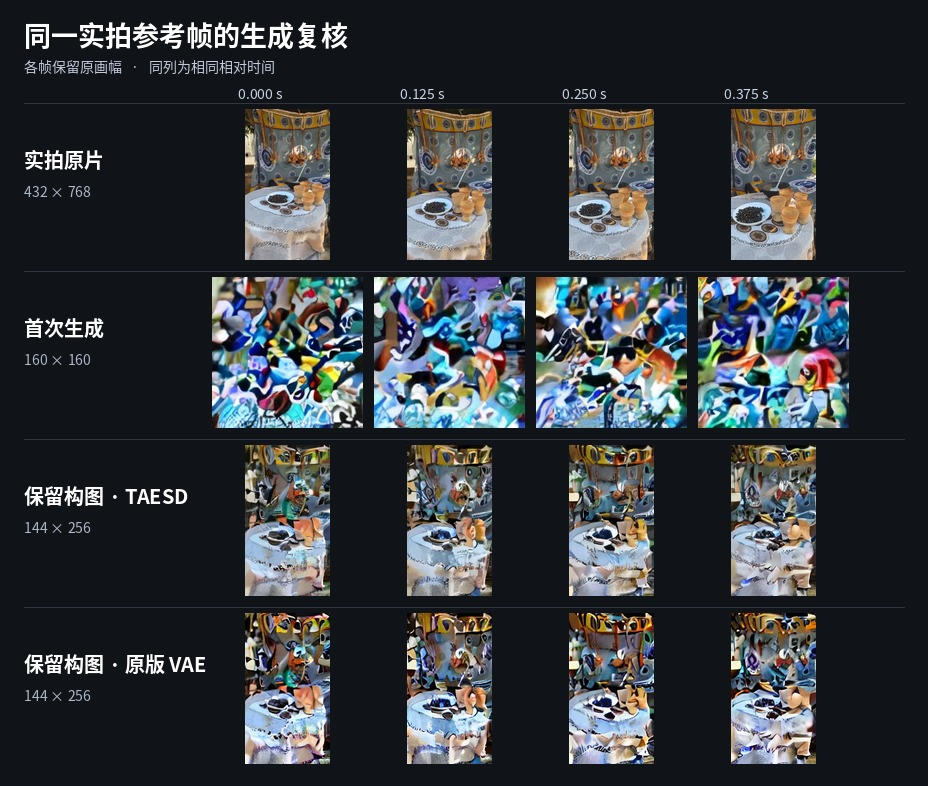

# 同一镜头位的实拍与扩散生成验收

同一批次的两个序号共用一个镜头位，候选为实拍的 1.0–1.5 秒区间，或由该原片 1.239 秒处的画面引导 AnimateDiff 生成。镜头配方的生成预算为 1，在途窗口为 1。素材、作业和成片均经项目的正常 API 入库和查询。

| 文件 | 内容 |
| --- | --- |
| [camera.mp4](camera.mp4) | 实拍区间直接剪出的 0.5 秒 H.264 成片 |
| [model-output.webm](model-output.webm) | ComfyUI 模型直接返回的 160 × 160、8 fps、四帧 VP9 动态原件 |
| [generated.mp4](generated.mp4) | 系统将同一生成原件剪入时间线并导出的 0.5 秒 H.264 成片 |
| [text-model-output.webm](text-model-output.webm) | 从单条制作接口独立提交纯文字提示，模型产生四个不同的 VP9 帧 |
| [inference.json](inference.json) | 成片摘要、独立解码数、预算、状态变化、工作器与权重版本、原片时码及像素核验 |

第 30 帧自零起算，在原片 25 fps 的时间基上覆盖 1.200–1.240 秒。独立 FFmpeg 解码该帧的 RGBA 像素，与工作器收到的 PNG 解码像素逐字节相同。三个混排相关文件和另行生成的纯文字视频都经过 FFmpeg 全片解码。报告中的项目及产物 ID 对应这一轮隔离测试数据库。

复验需要在 ComfyUI 安装 SD1.5 和 AnimateDiff-Lightning 两套模型。启动本地工作器后，在项目根目录执行以下命令，输出目录须为新目录。

```sh
python scripts/verify_mixed_generation.py --base-url http://127.0.0.1:8188 --tiny-vae --output evidence/my-mixed-inference
```

工作器使用 ComfyUI 0.3.70、AnimateDiff-Evolved 90fb133、PyTorch 2.8.0+cpu。本机以 FP8 保存 UNet 和文本编码器权重，CPU 进行推理，TAESD 编解码器使用 FP32。两次使用 FP16 UNet 的尝试中，工作器被系统终止，队列保留了已提交请求的身份并暂停该批次，一次保留完整 FP16 VAE、仅量化 UNet 和文本编码器的尝试也在解码阶段终止。最终使用 TAESD 的请求在独立测试项目重新提交。复验时需按实际可用内存选择精度。

## 成片复核

混合配方实际使用一次推理。入列后的 0.906 秒实拍成片已就绪，30.225 秒两个序号都完成。另一次纯文字单条请求从提交到下载核验用了 16.761 秒。这两次都是 0.5 秒的小样，时间只覆盖这次机器、模型和画面规格。

实拍直剪片中，桌子、容器和桌布仍可辨认。参考帧生成的四帧出现明显彩色扭曲，原来的容器和桌面难以辨认。纯文字生成的四帧有颜色跳变和横向色块，未清楚表现提示中的咖啡豆。两份生成样片的商品视觉审阅都应拒绝发布。

### 降低去噪后的两次实测

三组候选使用同一实拍源帧和种子。第二轮根据原片修正提示词，要求保留桌面、杯、盘和桌布，将模型画幅改为与原片一致的 144 × 256 竖屏，并将去噪强度从 0.35 降到 0.12。Euler、`sgm_uniform` 和 CFG 1 参照发布者的 ComfyUI 工作流，采样步数与两步权重匹配。只在第二轮的两个候选之间比较两种 VAE。第一轮到第二轮同时调整了提示、画幅、采样步数和去噪，不能据此估计每一项改变的独立作用。[ByteDance 参考工作流](https://huggingface.co/ByteDance/AnimateDiff-Lightning/blob/main/comfyui/animatediff_lightning_workflow.json)

| 参考帧生成候选 | 颜色平均绝对误差（固定参考帧，逐帧范围） | 亮度相关系数范围 | 相邻帧颜色变化范围 | 观察 |
| --- | ---: | ---: | ---: | --- |
| [首次样片](model-output.webm) | 0.138–0.155 | 0.598–0.667 | 0.168–0.185 | 彩色扭曲掩盖原来的杯子、盘和桌布 |
| [低去噪，TAESD](low-denoise-tiny.webm) | 0.065–0.074 | 0.885–0.914 | 0.077–0.083 | 19.194 秒完成，能辨认桌面的布局，逐帧杯形仍然漂移 |
| [低去噪，原版 VAE](low-denoise-full.webm) | 0.081–0.089 | 0.875–0.914 | 0.087–0.095 | 35.810 秒完成，完整 VAE 使用 FP32 分块编解码，明显色斑和轮廓漂移仍在 |

全部视频取相同的中心正方形视场，比对 16 × 16 低频 RGB 图，颜色值归一到 0–1。相关系数对照的是生成所用的固定源帧。它不会评估逐个杯子的几何身份，也无法区分真实镜头运动和物体形变。参考实拍连续四帧的相邻变化为 0.068–0.103。四个生成帧的字节存在区别，两个新候选的产品一致性审阅仍然应拒绝。图中保留各自的完整画幅。[逐帧数值与两份可复验的 Comfy API 图](comparison.json)



## 素材与模型来源

实拍直剪、参考帧生成原件和对应 H.264 成片据 Keria T 的《Traditional Ethiopian Coffee Roasting Ceremony》改编。使用仓库保存的 Wikimedia Commons 原片九秒署名摘录。这里进行了裁剪、画面尺寸调整或参考帧条件生成。这三份衍生媒体、两份低去噪参考帧候选及其对比图均继续使用 CC BY-SA 4.0。[原片与署名](https://commons.wikimedia.org/wiki/File:Traditional_Ethiopian_Coffee_Roasting_Ceremony.webm) · [许可原文](https://creativecommons.org/licenses/by-sa/4.0/)

实测的 SD1.5 和 AnimateDiff-Lightning 权重均按模型卡标注 CreativeML Open RAIL-M。两份权重的本地 SHA-256 与发布方 Git LFS 对象摘要一致，详细值保存在核验报告。[Comfy Org SD1.5](https://huggingface.co/Comfy-Org/stable-diffusion-1.5) · [ByteDance AnimateDiff-Lightning](https://huggingface.co/ByteDance/AnimateDiff-Lightning)

测试使用的 TAESD 小型编解码器由 madebyollin 发布，项目源码与权重采用 MIT 许可。[TAESD 项目与许可](https://github.com/madebyollin/taesd)

[审片界面实机截屏](visual-review/desktop.jpg) 包含同一原片和衍生候选的画面，亦以 Keria T 的原片署名和 CC BY-SA 4.0 许可发布。
