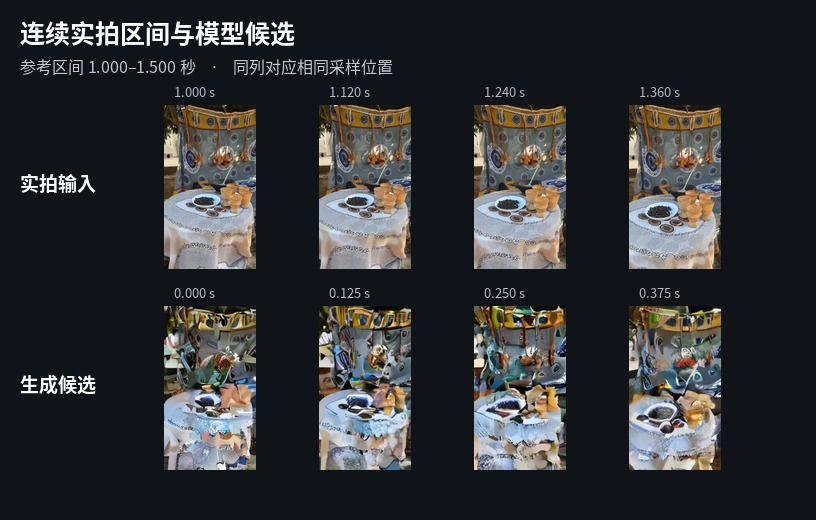

# 连续实拍区间生成及逐帧核验

单条生成入口接收固定素材修订和半开区间 [1.000, 1.500) 秒。按 8 fps 查询四次显示位置，在原片 25 fps 的第 25、28、31、34 帧实际得到 1.000、1.120、1.240、1.360 秒。每个位置都从实际原片取样。FFmpeg 将显示画面等比例缩至 288 × 512，转为无音轨的无损 RGB H.264 MP4。对上传文件独立解码，与原片对应画面比较，四帧共 1,769,472 个 RGB 通道值全部相等。文件及四个不同的逐帧 SHA-256 见 [像素核对](pixel-audit.json)。

CPU ComfyUI v0.3.70 使用内置 LoadVideo、GetVideoComponents 将四帧的图像批次送入 VAEEncode 和 AnimateDiff-Lightning，最终生成四帧不同的 144 × 256、8 fps VP9。登记示例使用 SD1.5 原版 VAE，此次实跑使用 TAESD 压低内存。2 个 Euler/sgm_uniform 采样步，去噪系数 0.12，CFG 1.0，种子 48185。API 从请求到 ready 20.338 秒。上传文件 SHA-256、工作流图、模型回执、状态时序和生成文件 SHA-256 见 [推理记录](inference.json)。

**审片结论为拒绝商品交付。** 同列对应相同帧位置。原片桌面与摆盘关系仍可辨认，但生成画面中前景杯身、杯口和花纹桌布发生变形。四帧全流程证明区间确实参与推理，商品外观保真尚未达标。[逐帧对比指标](comparison.json)



可用以下命令复核现有文件。启动有 SD1.5、AnimateDiff-Lightning 和 TAESD 的本地 ComfyUI 后，第二条命令可独立重走导入、提交、幂等重放、轮询、下载、逐帧像素复核。输出目录须为新目录。安装模型来源、校验和适用许可记录在[同一环境的模型实测](../mixed-routing/README.md)。

```bash
python scripts/verify_video_segment.py --audit --folder evidence/batch-production/video-segment
python scripts/verify_video_segment.py --base-url http://127.0.0.1:8188 --tiny-vae --folder /tmp/video-segment-replay
```

reference.mp4、candidate.webm 及比较图根据 Keria T 的《Traditional Ethiopian Coffee Roasting Ceremony》制作，含裁剪、等比缩放、重采样及模型改编。上述衍生媒体沿用 CC BY-SA 4.0。[Wikimedia Commons 原作品](https://commons.wikimedia.org/wiki/File:Traditional_Ethiopian_Coffee_Roasting_Ceremony.webm) · [许可原文](https://creativecommons.org/licenses/by-sa/4.0/)
